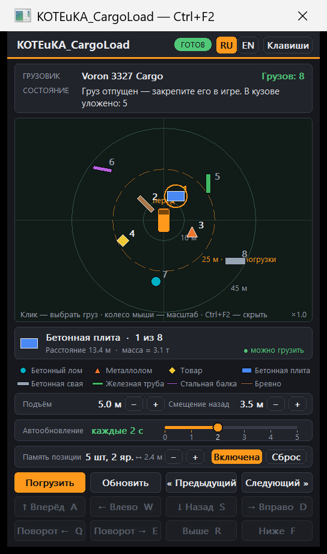
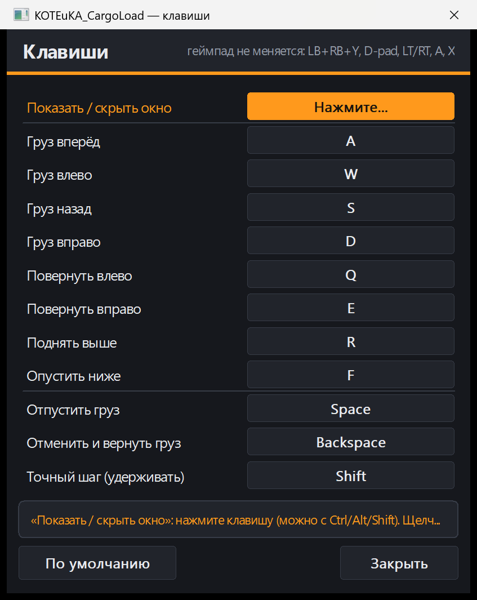
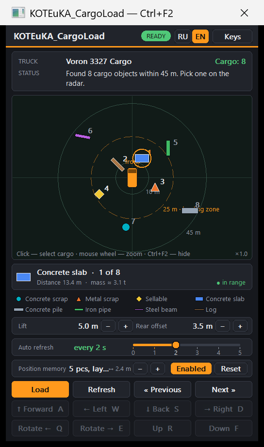
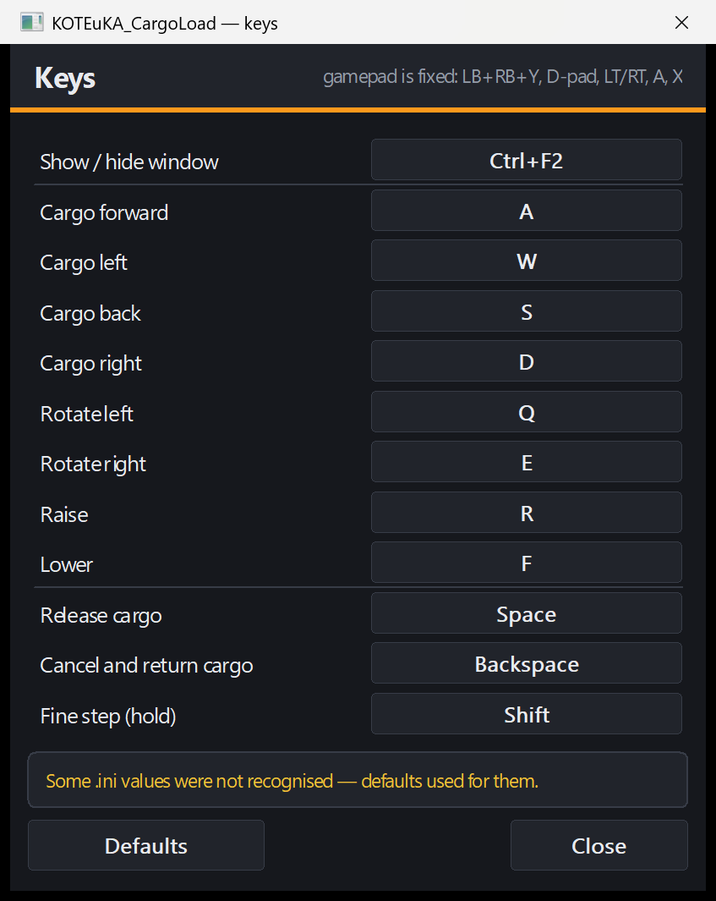

# KOTEuKA_CargoLoad

Мод для **RoadCraft** (одиночный режим): погрузка груза в кузов грузовика через радар — без крана.
Открываете окно, выбираете груз на радаре, нажимаете «Погрузить», двигаете груз над кузовом клавишами и отпускаете.

Интерфейс на русском и английском (переключатель **RU | EN**), все клавиши переназначаются.

| Радар | Окно «Клавиши» |
|---|---|
|  |  |
|  |  |

> Основано на открытом исходном коде мода **Automatic Cargo Load** автора **Athengard**
> ([github.com/Athengard/automatic-cargo-load](https://github.com/Athengard/automatic-cargo-load)).
> Публикуется с разрешения автора оригинала. Основная логика физики и распознавания грузов — из оригинала;
> интерфейс, поиск по сигнатурам, настройки, клавиши, память позиции и локализация — переработка KOTEuKA.

---

## Возможности

- **Радар** с кольцами 10 / 25 / 45 м: грузы рядом с вашим грузовиком, тип, расстояние, масса.
  Пунктирное кольцо 25 м — зона, из которой можно грузить. Колесо мыши — масштаб.
- **Погрузка в один клик**: груз поднимается над кузовом, дальше вы его двигаете:
  WASD — вперёд/влево/назад/вправо, Q/E — поворот, R/F — выше/ниже,
  Enter — отпустить, Esc — отменить и вернуть груз на место.
- **Точный шаг** — удерживайте Shift (геймпад: X): 5 см и 5° вместо 25 см и 15°.
- **Память позиции** — мод запоминает, где лежит предыдущий груз, и ставит следующий вплотную рядом
  (зазор 10 см); когда ряд по ширине кузова заполнен — сверху, новым ярусом. Ширина кузова настраивается (1–4 м).
- **Автообновление радара** — ползунок 0…5 с (0 — только вручную).
- **Настройки подъёма и смещения** кнопками −/+ прямо в окне.
- **Переназначение всех 12 клавиш** в окне «Клавиши»: щёлкнуть по действию и нажать новую клавишу.
  Для показа окна можно сочетание (например Ctrl+F2). Занятые клавиши не принимаются.
- **Геймпад**: LB+RB, затем Y — открыть окно; D-pad — выбор груза; A — погрузить/отпустить; X — точный шаг.
- **Русский и английский интерфейс**, выбор сохраняется; по умолчанию — язык Windows.
- **Поиск адресов игры по сигнатурам** — мод не зависит от жёстких адресов одной сборки и честно
  отключается, если что-то не совпало.
- Окно запоминает положение и размер, всё хранится в `KOTEuKA_CargoLoad.ini`.

## Установка

1. Скачайте готовые файлы из раздела **Releases** (или соберите сами — см. ниже):
   `KOTEuKA_CargoLoad.dll`, `version.dll`, `KOTEuKA_CargoLoad.ini`, `KOTEuKA_CargoLoad.profiles`.
2. Закройте игру. Если стоял оригинальный Automatic Cargo Load — удалите его файлы
   (`RoadCraftAutoload.*` и `version.dll`), иначе загрузятся оба мода.
3. Скопируйте 4 файла в папку с `Roadcraft - Retail.exe`, обычно
   `...\steamapps\common\RoadCraft\root\bin\pc`.
4. Запустите игру, сядьте в грузовик и нажмите **F1**.

**Обновление:** копируйте только `KOTEuKA_CargoLoad.dll` — `.ini` в папке игры хранит ваши настройки.
**Удаление:** удалите 4 файла и `KOTEuKA_CargoLoad.log`.

Подробная инструкция на русском — [УСТАНОВКА_RU.txt](УСТАНОВКА_RU.txt).

## Настройки (`KOTEuKA_CargoLoad.ini`)

```ini
[Loading]
RearOffsetCm=350     ; смещение назад от центра (только Voron 3327 Crane Cargo)
DropHeightCm=500     ; высота подъёма груза над кузовом
BedLayout=1          ; память позиции вкл/выкл
BedWidthCm=240       ; ширина кузова для памяти позиции

[Radar]
AutoRefreshSec=0     ; 0 — вручную, 1…5 — каждые N секунд

[Keys]
Radar=F1             ; можно сочетание: Ctrl+F2, Alt+Q …
MoveForward=W
Release=Enter
Cancel=Esc
Fine=Shift

[UI]
Language=ru          ; ru | en
```

Всё это меняется из окна мода, вручную править не обязательно.

---

## Принцип работы

### 1. Загрузка в игру

Windows при запуске игры ищет системную `version.dll` сначала в папке программы.
Мод кладёт туда **прокси `version.dll`** (`src/version_proxy.c`):

- все функции `GetFileVersionInfo*` / `VerQueryValue*` прозрачно перенаправляются в настоящую
  `C:\Windows\System32\version.dll` — игра работает как обычно;
- дополнительно прокси загружает `KOTEuKA_CargoLoad.dll` из той же папки.

`KOTEuKA_CargoLoad.dll` запускает собственный поток с окном (обычное окно Windows поверх игры, GDI).
Мод работает **внутри процесса игры** и не изменяет `.exe`, `.pak` или сохранения на диске.

### 2. Поиск адресов по сигнатурам

Мод должен вызывать функции игры и читать её структуры, а адреса меняются от сборки к сборке.
Поэтому при старте (~0,2 с) он ищет **16 адресов по шаблонам байтов** (AOB) в образе
`Roadcraft - Retail.exe` (`src/signatures.inc`):

| Группа | Что | Зачем |
|---|---|---|
| `FN_QUEUE`, `FN_MOTION` | функции очереди физики Havok | двигать груз |
| `FN_KEYBOARD`, `SLOT_KEYBOARD` | обновление клавиатуры игры | перехват клавиш на время размещения |
| `FN_CAMERA_CTOR`, `VT_CAMERA` | камера машины | определить, в каком грузовике вы сидите |
| `VT_SHAPE_*`, `VT_BODY`, `VT_CONSTRAINT` | таблицы методов форм и тел | распознать тип формы груза |
| `G_WORLD`, `G_ALLOC`, `G_PAD_GETSTATE` | глобальные переменные | физический мир, выделение памяти, геймпад |

Правила безопасности поиска:
- каждый шаблон должен совпасть **ровно один раз**, иначе мод ничего не трогает и пишет причину;
- найденный адрес должен лежать в правильной секции exe (код — в `.text`, данные — в `.rdata`/`.data`);
- таблица методов должна начинаться с указателя на код;
- перед каждым вызовом функции игры её первые байты сверяются с ожидаемыми.

Результат (и отличия от известной сборки 8.0.PATCH.772884) пишется в `KOTEuKA_CargoLoad.log`.
Сигнатуры генерирует `tools/aobgen.py` по exe игры, проверяет без запуска игры `tools/aob_test.c`.

### 3. Радар: поиск грузовика и грузов

По кнопке «Обновить» (или по таймеру автообновления) мод читает физический мир Havok:
мир → «острова» (группы тел) → твёрдые тела. Для каждого тела читаются поза (матрица 4×4),
центр масс, обратный тензор инерции, форма и имя кости.

- **Грузовик.** Платформы кузовов известны заранее (`src/truck_platforms.inc`: кость, масса, высота
  платформы). Из найденных кузовов выбирается тот, что ближе всего к **фокусу камеры машины** —
  то есть грузовик, в котором вы сейчас едете. Камеру мод один раз находит в памяти по её таблице
  методов (в фоновом потоке) и потом только перепроверяет.
- **Грузы.** Тип определяется по «отпечатку» тела: масса + обратная инерция
  (`KOTEuKA_CargoLoad.profiles`) и геометрия выпуклой оболочки формы, сверенная с каталогом
  (`src/cargo_catalog.inc`): бетонный лом, металлолом, плиты, сваи, трубы, балки, брёвна, товары.
- В список попадают только грузы в радиусе сканирования вокруг грузовика, сортировка по расстоянию.

### 4. Погрузка и размещение

Груз двигается **не записью в память напрямую**, а штатными командами очереди физики Havok
(через функцию игры `FN_QUEUE`), как это делает сама игра:

| Операция | Что делает |
|---|---|
| 4 — тип движения | перевести груз в управляемый режим (4), потом вернуть исходный |
| 25 — поза | поставить груз в заданную точку с заданным поворотом |
| 26 / 27 — скорость | обнулить линейную и угловую скорость |

Порядок:
1. Проверки: тот же мир/карта, тот же грузовик, груз того же типа, не дальше 25 м,
   лежит свободно, состоит из одной части (составные грузы — только краном).
2. Точка над кузовом считается по профилю платформы, высоте подъёма и ориентации груза;
   если включена память позиции — рядом с предыдущим грузом (габариты — из оболочки формы).
3. Груз переводится в управляемый режим и ставится над кузовом, окно прячется, фокус — игре.
4. Каждое нажатие WASD/QE/RF — новая поза (шаг 25 см / 15°, с Shift — 5 см / 5°).
5. **Отпустить** — возвращается исходный тип движения, скорости обнуляются, груз падает
   под действием физики игры; положение запоминается для памяти позиции.
   **Отменить** — груз возвращается в исходную точку с исходным поворотом.

После погрузки груз закрепляется обычным способом игры.

### 5. Клавиатура и геймпад

Пока груз размещается, клавиши перемещения не должны доходить до игры (иначе поедет машина).

- **Клавиатура.** В таблице методов клавиатуры игры подменяется один указатель (`SLOT_KEYBOARD`)
  на функцию-фильтр. Фильтр вызывает оригинальное обновление, затем читает массив состояний
  DirectInput (индекс — DIK-код клавиши), запоминает нажатые клавиши мода и обнуляет их для игры.
  Вне размещения фильтр ничего не меняет. Перед подменой сверяются байты оригинальной функции.
- **Геймпад.** Так же подменяется указатель на `XInputGetState` (`G_PAD_GETSTATE`); исходный
  указатель (в том числе обёртка оверлея Steam) сохраняется и вызывается дальше.
- **Переназначение.** Виртуальный код клавиши Windows переводится в DIK-код через `MapVirtualKey`;
  для расширенных клавиш (стрелки, Insert/Delete, Home/End, PageUp/PageDown, правые Ctrl/Alt)
  бит 0x80 ставится явно. Левый и правый Shift/Ctrl/Alt и оба Enter считаются одной клавишей.
- Окно показа/скрытия — системная горячая клавиша (`RegisterHotKey`); если её заняла другая
  программа, мод временно берёт F1.

### 6. Интерфейс и локализация

- Окно рисуется вручную через GDI в логической сетке 520×858, масштабируется под размер окна
  и DPI монитора, двойная буферизация, тёмная тема.
- Все строки проходят через макрос `TR(ru, en)`; в статических таблицах — отдельные поля `*En`.
  Переключение языка перерисовывает окно сразу.

---

## Сборка из исходников

Нужен **Visual Studio** (2019 и новее) с компонентом «Разработка классических приложений на C++» (MSVC x64).

```powershell
powershell -ExecutionPolicy Bypass -File build.ps1
```

Скрипт находит MSVC через `vswhere`, собирает `KOTEuKA_CargoLoad.dll` и `version.dll` в `build\`
и копирует их вместе с `.ini` / `.profiles` рядом со скриптом.

Ключи компилятора: `/utf-8 /O2 /MT /LD /TC` (C, статический CRT — внешние зависимости не нужны).

### Проверка сигнатур после обновления игры

```powershell
# в «x64 Native Tools Command Prompt» Visual Studio:
cl /nologo /utf-8 /TC /I src tools\aob_test.c /link user32.lib gdi32.lib
aob_test.exe "путь\к\Roadcraft - Retail.exe"               # все 16 адресов должны найтись

# если не нашлись — подобрать новые шаблоны:
python tools\aobgen.py "путь\к\Roadcraft - Retail.exe" aob.json
# затем перенести шаблоны из aob.json в src\signatures.inc
```

## Структура

```
src/
  KOTEuKA_CargoLoad.c     весь мод: сигнатуры, радар, физика, клавиши, интерфейс
  version_proxy.c         прокси version.dll, загружает мод
  version.def             экспорт функций прокси
  signatures.inc          16 AOB-шаблонов (генерируется aobgen.py)
  cargo_catalog.inc       геометрия известных грузов
  truck_platforms.inc     платформы кузовов грузовиков
  KOTEuKA_CargoLoad.ini        настройки по умолчанию
  KOTEuKA_CargoLoad.profiles   отпечатки грузов (масса + инерция)
tools/
  aobgen.py               генератор сигнатур по exe игры
  aob_test.c              офлайн-проверка поиска сигнатур
  patch_aob.py            разовый скрипт перехода на сигнатуры (история)
  preview_host.c          отрисовка окон без игры (скриншоты preview*.png)
  en.tsv, check_ru.py, ctok.py   перевод и проверка, что у всех строк есть английская пара
build.ps1                 сборка
УСТАНОВКА_RU.txt          подробная инструкция для игрока
```

## Что проверено

- Игра 8.0.PATCH.772884: все 16 сигнатур находятся; на чужом exe поиск корректно отказывает.
- Проверено в игре: погрузка, сигнатуры, точный шаг, настройки, положение окна, автообновление,
  память позиции (положение примерное).
- Без игры (тестами и скриншотами): переназначение клавиш и английская локализация.

## Ограничения

- Только **одиночный режим**.
- Составные грузы (из нескольких тел) не поддерживаются — их грузите краном.
- Память позиции даёт примерное положение: размеры берутся из физической формы груза.
- Если обновление игры изменит структуры (смещения полей), сигнатуры не совпадут и мод
  отключится с сообщением — нужна адаптация. Пришлите `KOTEuKA_CargoLoad.log`.
- Если игра не запускается — удалите `version.dll` из папки игры.

---

## English (short)

**KOTEuKA_CargoLoad** — a RoadCraft single-player mod that loads cargo onto your truck bed from a radar window,
no crane needed. Press **F1** in a truck, pick cargo on the radar, press *Load*, position it with
WASD / Q / E / R / F (hold Shift for fine 5 cm / 5° steps), Enter to release, Esc to cancel.
Features: position memory (next cargo is placed next to the previous one), radar auto-refresh,
full key remapping, Russian / English UI, AOB signature scanning instead of hardcoded addresses.

Install: copy `KOTEuKA_CargoLoad.dll`, `version.dll`, `KOTEuKA_CargoLoad.ini`, `KOTEuKA_CargoLoad.profiles`
next to `Roadcraft - Retail.exe`. Build: `powershell -ExecutionPolicy Bypass -File build.ps1` (MSVC x64).

Based on **Automatic Cargo Load** by **Athengard**
([github.com/Athengard/automatic-cargo-load](https://github.com/Athengard/automatic-cargo-load)),
published with the original author's permission.
